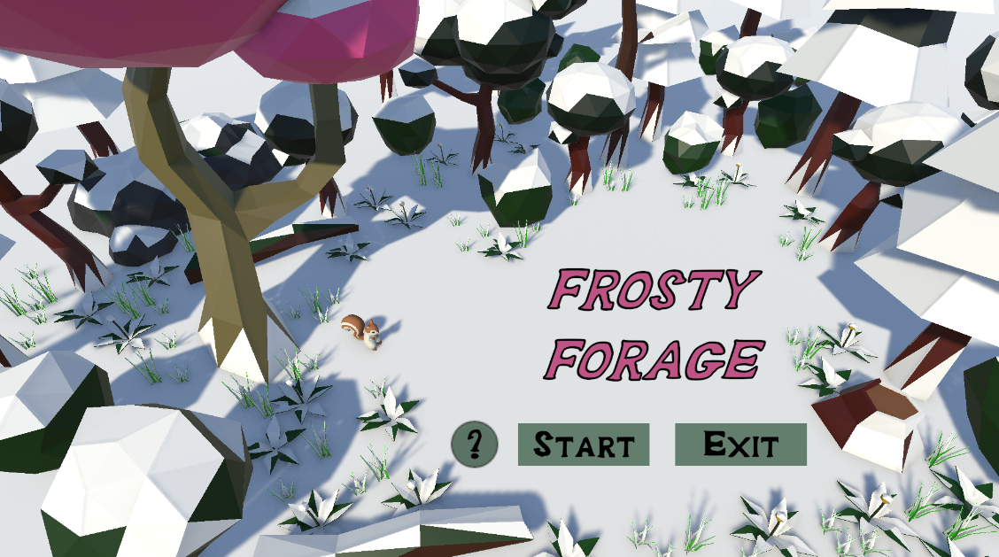
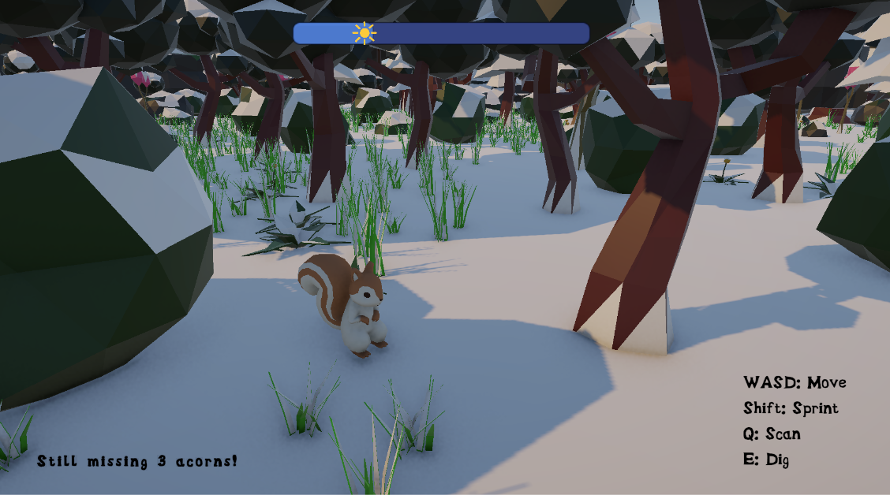
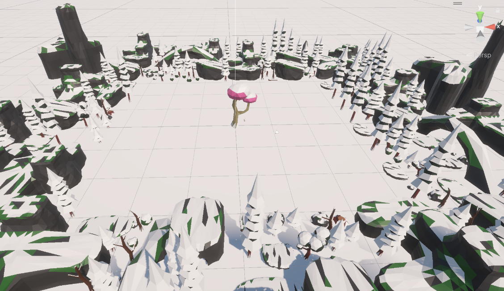
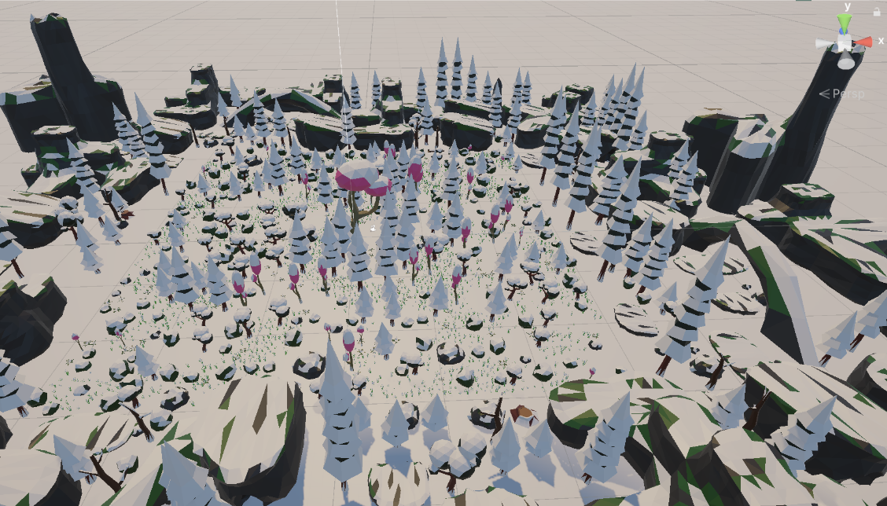

# Frosty Forage

**Frosty Forage** is a 3D exploration and treasure-hunting game developed in Unity. Play as a squirrel searching a procedurally generated forest for buried acorns. Use its sense of smell to locate nearby treasure, dig to collect it, and find three acorns before nightfall.

## Gameplay

The objective is to collect three acorns before the day ends.

- **Move:** Explore the forest and search for buried acorns.
- **Sprint:** Move faster when covering larger distances.
- **Scan:** Reveal the direction of the nearest acorn using a compass arrow.
- **Dig:** Attempt to collect an acorn within digging range.

The compass provides a distance-based visual hint: its color transitions from blue (far) through yellow to red (near). The direction and distance are captured when the squirrel sniffs, so the player must use the hint to navigate rather than rely on continuous tracking.

The day-night cycle creates a time limit. If nightfall arrives before all three acorns are collected, the squirrel falls asleep and the game transitions to the game-over screen.

## Procedural Forest Generation

The forest is generated using a layered procedural content generation system implemented in C#. Each object category has its own spawn layer, allowing its placement rules and distribution to be configured independently.

The generator currently handles six categories: acorns, trees, rocks, bushes, grass, and plants.

### Candidate point generation

Each layer generates its own candidate positions using **Poisson-disc sampling**. The sampler uses an active-list approach to distribute points while maintaining a configurable minimum separation.

A spatial grid accelerates the minimum-distance checks during sampling. Candidate points are shuffled before placement to avoid processing them in a fixed spatial order.

### Density and distribution

For each candidate position, the generator calculates a spawn probability using several configurable factors:

- **Layer and global density:** Control the overall probability of spawning an object.
- **Distance-based density curves:** Adjust spawn probability according to distance from the map center.
- **Crowding:** Optionally reduce or adjust spawn probability based on the number of nearby blocking objects.
- **Perlin noise:** Modulates spawn probability to produce natural-looking patches and open spaces.

These factors allow different object categories to have distinct spatial distributions. For example, grass and plants use Perlin noise to create clustered patches, while trees use distance-based rules and group clustering.

### Object selection and placement

Spawn layers contain weighted groups of prefab variants. The selection process considers nearby objects of the same layer: groups already represented nearby receive an increased selection weight, creating local clusters of similar object categories.

Prefab variants can be selected randomly or according to distance-based size curves. Additional variation is introduced through scale, rotation, and optional tilt.

Before an object is placed, its footprint is measured from its colliders (or renderers when colliders are unavailable). The measurements are cached and used for placement checks.

If a selected prefab overlaps an existing blocking object, the generator can attempt smaller variants before discarding the candidate position.

### Spatial queries and collision handling

A custom `SpatialGrid` stores placed-object information in spatial cells. Rather than comparing a candidate against every previously placed object, the generator queries nearby cells for:

- Collision and overlap checks
- Local crowding calculations
- Nearby object-group counts

Objects already present in the scene can also be registered as blockers, allowing generated objects to respect existing level geometry.

The generator supports configurable random seeds, map boundaries, edge margins, and optional ground snapping through raycasts.

## Gameplay Systems

### Squirrel controller

The squirrel controller uses Unity's `CharacterController` for movement and handles camera-relative navigation, sprinting, and timed actions.

Sniffing and digging temporarily prevent movement while their respective actions play. The controller also communicates collected acorns through an event, allowing the collection and win-condition systems to respond independently.

### Compass and hint system

The compass obtains the nearest active acorn when a sniff action completes. It captures the target's direction and distance and displays an arrow above the squirrel.

The arrow uses three distance colors and configurable fade-in and fade-out durations. Hints expire after a limited period, encouraging deliberate use of the sniff action.

### Day-night cycle

The day-night system updates the sun's rotation, light intensity, sunlight color, and ambient environment over the course of the day. A UI slider reflects the current time.

When the cycle reaches nightfall, it invokes the game's lose condition.

### Collection and game flow

Acorn collection is handled through the squirrel controller's collection event. The win-condition system updates the UI counter and transitions to the win screen once the required number of acorns has been collected.

If time runs out, the squirrel enters its sleeping state, accompanied by visual feedback, before the game-over screen is loaded.

## Controls

| Input | Action |
|---|---|
| W / A / S / D | Move |
| Left Shift | Sprint |
| Q | Sniff |
| E | Dig |
| Mouse | Rotate camera |
| R | Recenter camera |
| Escape | Return to main menu |

## Technologies

- Unity
- C#
- Poisson-disc sampling
- Perlin noise
- Spatial partitioning with a custom spatial grid
- Unity Character Controller and Physics
- Unity UI and TextMeshPro

## Screenshots

| Main Menu | Gameplay |
|:---:|:---:|
|  |  |
| **Base Map** | **Procedurally Generated Map** |
|  |  |

## Credits

Developed by **Cooptet**.

Environment and visual assets include resources from the Unity Asset Store. Gameplay systems, procedural generation, and game logic were implemented specifically for this project.
